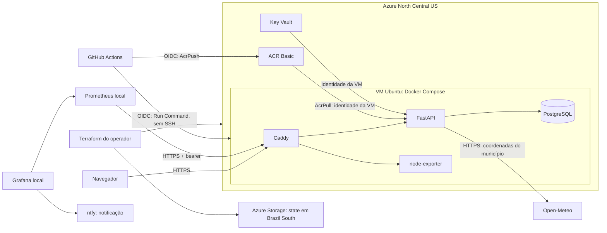

# Vigia da Chuva

Previsão de chuva em linguagem simples e relatos recentes de alagamento por município.

[Abrir o MVP](https://vigia-chuva-on6r0.northcentralus.cloudapp.azure.com) · [Pipeline](https://github.com/gciziks/gs-cloud-2026-2/actions) · [Relatório PDF](docs/relatorio.pdf)

## Integrantes

| Nome | RM |
|---|---|
| Cassio Valezzi | 551059 |
| Gabriel Ciziks | 98215 |
| Lucca Sabatini Tambellini | 98169 |
| Victor Nuzzi | 98209 |

## Ficha Técnica do MVP

| Campo | Descrição |
|---|---|
| Nome do produto | Vigia da Chuva |
| Cidadão e território | Moradores de áreas urbanas sujeitas a alagamento; consulta por município brasileiro |
| Problema em uma frase | A informação sobre chuva forte e ruas alagadas chega de forma dispersa e difícil de consultar. |
| Proposta de valor | Consultar uma previsão real, entender a intensidade esperada e compartilhar uma referência de alagamento, sem criar conta. |
| Arquitetura | FastAPI, PostgreSQL, Caddy e node-exporter em Docker Compose numa VM Azure; Terraform, ACR e Key Vault; GitHub Actions; Prometheus e Grafana locais. |
| Fontes de dados | Open-Meteo, API de localidades do IBGE, coordenadas de kelvins/municipios-brasileiros e relatos dos visitantes. |
| Modelos de IA utilizados | Nenhum no MVP. |
| URL do MVP e repositório | [MVP](https://vigia-chuva-on6r0.northcentralus.cloudapp.azure.com) e [repositório](https://github.com/gciziks/gs-cloud-2026-2) |
| Indicadores de impacto | Propostos: consultas por município, relatos por evento e proporção de relatos em períodos de chuva forte. Não houve medição de impacto social nesta entrega. |
| ODS conectados | ODS 11, meta 11.5; ODS 13, meta 13.1. |

## Como testar

1. Abra o MVP e busque `Campinas`.
2. Consulte o nível calculado e a tabela horária. A previsão muda com os dados reais; um dia seco deve aparecer sem alerta.
3. Registre um relato com bairro, referência de via pública e situação. Não informe dados pessoais.
4. Confira o relato na mesma página. São permitidos cinco envios por IP por hora.

Os níveis representam uma estimativa de intensidade da chuva. Não são avisos oficiais nem uma previsão de alagamento de uma rua. Relatos são contribuições dos visitantes, sem validação pela Defesa Civil. Em emergências, ligue 199.

## Arquitetura



Somente 80 e 443 estão liberadas na VM. App, banco e exporter não publicam portas no host. Não há regra SSH. A VM é administrada pelo plano de controle Azure, com `az vm run-command`.

Brazil South não disponibilizou os tamanhos econômicos para esta assinatura. North Central US tinha quota e o menor preço entre as alternativas verificadas. O banco fica nos Estados Unidos; a documentação de privacidade informa essa localização.

## Rodar localmente

Requisitos: Docker Desktop com containers Linux, Git e Python 3.12. Os comandos abaixo usam Bash, disponível no Git Bash do Windows.

```bash
git clone https://github.com/gciziks/gs-cloud-2026-2.git
cd gs-cloud-2026-2
cp .env.example .env
python scripts/preparar_env.py
docker compose up -d --build
docker compose ps
```

Abra [localhost:8080](http://localhost:8080). `/healthz` verifica a aplicação e `/readyz` verifica o banco. `/metrics` e `/node-metrics` exigem o bearer token do `.env`. O Caddy sobrescreve o IP encaminhado pelo cliente, evitando que o cabeçalho seja usado para contornar o limite de relatos.

Para parar, use `docker compose down`. Os volumes são preservados. Não use `down -v` se quiser manter os relatos.

## Testes

```bash
python -m venv .venv
# Linux/macOS/Git Bash com Python do Linux:
source .venv/bin/activate
# No Git Bash com Python do Windows, use: source .venv/Scripts/activate
pip install -r app/requirements-dev.txt
ruff check app scripts/gerar_municipios.py
pytest app -v
```

O teste PostgreSQL exige `TEST_DATABASE_URL` apontando para um banco exclusivo de teste. Ele remove registros de Campinas nesse banco. Nunca aponte essa variável para produção. O pipeline cria automaticamente um PostgreSQL separado e executa a suíte inteira, incluindo o teste de concorrência do limite por IP.

## Infraestrutura Azure

Requisitos: Azure CLI autenticado, Terraform >= 1.10, quota para a VM escolhida e permissão de criar recursos e atribuir RBAC na assinatura. Registre os providers Compute, Network, Storage, KeyVault, ContainerRegistry, ManagedIdentity e Consumption antes de executar. O provider Terraform não registra serviços alheios ao projeto automaticamente.

```bash
az login
export ARM_SUBSCRIPTION_ID=$(az account show --query id -o tsv)
cd infra/bootstrap
terraform init
# Criar terraform.tfvars local com ip_operador: IPv4 público do operador, sem máscara.
terraform plan -out=bootstrap.tfplan
terraform apply bootstrap.tfplan
```

Os outputs identificam o storage do state. Copie `infra/main/backend.hcl.example` para `backend.hcl` e preencha com esses outputs. Copie `terraform.tfvars.example` para `terraform.tfvars`; preencha `ip_operador` e `chave_ssh_publica`. A chave pública satisfaz a API da VM, mas não abre SSH. Os arquivos reais são ignorados pelo Git.

```bash
cd ../main
terraform init -backend-config=backend.hcl
terraform fmt -check -recursive ..
terraform validate
terraform plan -out=main.tfplan
terraform apply main.tfplan
```

Para testar a restrição administrativa, `terraform plan -var='admin_cidr=0.0.0.0/0'` deve falhar. O padrão é `admin_cidr = null`, sem SSH. Não é necessário abri-lo para deploy ou manutenção.

O GitHub pode emitir um subject OIDC com IDs imutáveis do dono e do repositório. A variável `github_oidc_subject` permite registrar exatamente o subject apresentado pelo `azure/login`, por exemplo `repo:dono@123/projeto@456:environment:producao`. Se não houver essa configuração, o padrão é `repo:dono/projeto:environment:producao`. Issuer e audience permanecem restritos ao GitHub e ao Azure.

No environment `producao`, cadastre `AZURE_CLIENT_ID`, `AZURE_TENANT_ID` e `AZURE_SUBSCRIPTION_ID` com os outputs Terraform. No repositório, configure `ACR_NOME`, `ACR_LOGIN_SERVER`, `RG_NOME`, `VM_NOME`, `KV_NOME` e `MVP_HOST`. Restrinja o environment à branch `main`. Os IDs não são senhas; a autenticação usa tokens OIDC curtos, sem client secret Azure. O login server vem do Terraform, evitando conceder leitura administrativa do registry à identidade de deploy.

## Pipeline e deploy

Cada push executa testes, validação Terraform, Gitleaks e Semgrep. Só depois desses jobs passa para build e Trivy. Falhas bloqueiam o deploy.

| Ferramenta | O que verifica |
|---|---|
| Gitleaks | Segredos no histórico Git, com valores ocultados nos logs |
| Semgrep | Padrões de código inseguros, como execução de shell e consultas SQL concatenadas |
| Trivy | Vulnerabilidades HIGH/CRITICAL com correção disponível na imagem da aplicação; configurações da infraestrutura e do Dockerfile |
| pytest e Ruff | Regras de domínio, falhas do serviço de previsão, validação de relatos, métricas e estilo |

Na `main`, a imagem que passou no Trivy é exportada como artefato, carregada no job de deploy e enviada ao ACR, sem reconstrução. O checkout do mesmo commit é transmitido como bundle pelo Run Command. Assim, o deploy funciona com repositório privado e nenhum token GitHub precisa ficar na VM.

A VM usa sua identidade para ler Key Vault e puxar o ACR. Os três segredos de runtime são gerados pelo Terraform. O `.env` da VM tem permissão 600. O script só emite `DEPLOY_OK <sha>` depois de verificar saúde e prontidão. O job confere esse marcador, pois o retorno do comando Azure sozinho não comprova sucesso do script remoto. Uma falha restaura a imagem e os arquivos da versão anterior.

## Observabilidade

Veja [observability/README.md](observability/README.md). Prometheus e Grafana rodam localmente e consultam o MVP publicado com bearer token. Suas portas são restritas a `127.0.0.1`. O dashboard provisionado mostra latência, tráfego, erros e saturação. As regras e o dashboard persistem após reinício.

O alerta de indisponibilidade verifica o endpoint de métricas da aplicação. A demonstração para apenas o serviço `app`, observa o estado firing e o restaura, sem desligar a VM ou apagar dados. O envio ntfy exige tópico aleatório configurado localmente.

## Dados e limiares

| Fonte | Uso e licença |
|---|---|
| [Open-Meteo](https://open-meteo.com/) | Precipitação horária e probabilidade, cache de 30 min; dados CC BY 4.0; endpoint gratuito usado para fins acadêmicos não comerciais. |
| [IBGE Localidades](https://servicodados.ibge.gov.br/api/docs/localidades) | Nomes e códigos oficiais de municípios. A base gerada nesta entrega contém 5.571 registros retornados pela API. |
| [kelvins/municipios-brasileiros](https://github.com/kelvins/municipios-brasileiros) | Coordenadas e fusos; licença MIT. O script cruza os códigos com o IBGE e recusa registros sem coordenadas. Manaus usa `America/Manaus`. |
| Visitantes | Relatos de via pública; não são dados oficiais nem verificados. |

Na janela das próximas 24 horas, o maior nível aplicável vence. Limites inclusivos:

| Nível | Pico por hora ou acumulado |
|---|---|
| Alerta máximo | >= 60 mm/h ou >= 100 mm |
| Alerta | >= 30 mm/h ou >= 50 mm |
| Atenção | >= 20 mm/h ou >= 30 mm |
| Sem alerta | Abaixo desses limites |

Os limiares são uma adaptação dos [avisos de chuvas intensas do INMET](https://avisos.inmet.gov.br/53675), aplicados a uma previsão e sem emissão de aviso oficial. O acumulado de 30 mm para atenção é uma escolha da equipe. Se o Open-Meteo falhar, a página informa indisponibilidade ou mostra a última previsão com aviso de desatualização.

## Privacidade e custos

O relato não pede nome, telefone ou e-mail. O IP é pseudonimizado com HMAC e data diária para limitar abuso; o código é apagado após 24 horas, com rotina a cada minuto. Relatos são removidos após sete dias. O banco fica em North Central US, nos Estados Unidos; segredos ficam no Key Vault. Logs do proxy mascaram IPs e a aplicação não grava logs de acesso. Não há dados pessoais nas métricas. Veja [privacidade](https://vigia-chuva-on6r0.northcentralus.cloudapp.azure.com/privacidade) e [relatório](docs/relatorio.md).

A estimativa de implantação por até 18 dias é de aproximadamente US$ 12, sem presumir benefícios gratuitos, considerando VM B2ats_v2, SSD de 32 GB, IP Standard, ACR Basic e pequena reserva para operações e tráfego. A referência mensal dos quatro itens fixos é US$ 17,98. Preços foram consultados na [Azure Retail Prices API](https://prices.azure.com/api/retail/prices) em 13/11/2026. O orçamento de R$ 60 usa a moeda de cobrança da assinatura e envia avisos; ele não interrompe serviços nem limita automaticamente o consumo.

## Desligar o ambiente

O relatório pode ser gerado novamente com `pip install -r docs/requirements.txt`, `python scripts/gerar_arquitetura.py` e `python scripts/gerar_relatorio.py`. As capturas exigem Node e `npm ci`, conforme as instruções de observabilidade. As respostas coletadas, execuções e resultados ficam em `docs/`, sem credenciais.

Manter o MVP disponível durante a correção, com referência até 30/11/2026. Depois da liberação da equipe:

```bash
cd infra/main
terraform destroy
cd ../bootstrap
terraform destroy
```

Isso exclui a infraestrutura e os dados do projeto. Execute primeiro em `infra/main`, enquanto o state remoto ainda existe, e depois no bootstrap. Não apague recursos de outros projetos da assinatura. Para apenas parar a observabilidade local, use `docker compose -f observability/compose.yaml down`.
