# Vigia da Chuva

Secure DevOps Tools & Cloud Computing

Global Solution 2026.2 | Deploy Blindado | 4º ano de Engenharia de Software

Cassio Valezzi, RM551059

Gabriel Ciziks, RM98215

Lucca Sabatini Tambellini, RM98169

Victor Nuzzi, RM98209

[MVP publicado](https://vigia-chuva-on6r0.northcentralus.cloudapp.azure.com) · [Repositório](https://github.com/gciziks/gs-cloud-2026-2) · [Workflow](https://github.com/gciziks/gs-cloud-2026-2/blob/main/.github/workflows/ci.yml) · [Execuções](https://github.com/gciziks/gs-cloud-2026-2/actions)

## 1. Ficha Técnica

| Campo | Conteúdo |
|---|---|
| Produto | Vigia da Chuva |
| Cidadão e território | Moradores de áreas urbanas sujeitas a alagamento, com consulta por município brasileiro. |
| Problema | Previsões técnicas e relatos dispersos dificultam saber o que ocorre perto de casa. |
| Proposta de valor | Consultar a intensidade prevista da chuva e compartilhar uma referência de alagamento sem cadastro. |
| Arquitetura | FastAPI, PostgreSQL, Caddy e node-exporter em Compose; VM Azure, ACR, Key Vault e Storage; Terraform; Actions com OIDC; Prometheus e Grafana locais. |
| Fontes | Open-Meteo, API IBGE, coordenadas de kelvins/municipios-brasileiros e relatos dos visitantes. |
| Modelos de IA | Nenhum no MVP. |
| URLs | MVP e repositório nos links da capa. |
| Indicadores de impacto | Propostos: consultas por município, relatos por evento e proporção de relatos durante chuva forte. Não medimos impacto social nesta entrega. |
| ODS | ODS 11, meta 11.5, e ODS 13, meta 13.1. |

A previsão usa dados reais e pode indicar tempo seco durante a avaliação. Para testar, busque Campinas, abra a previsão e registre um relato de via pública. O sistema não emite avisos oficiais e não prevê se uma rua específica vai alagar. Os relatos não são verificados pela Defesa Civil. O telefone 199 atende emergências.

## 2. Arquitetura e decisões

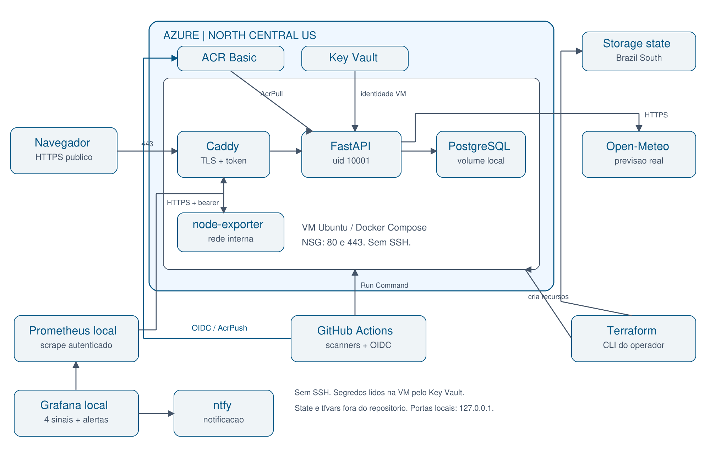

A VM Ubuntu está em North Central US. O NSG permite somente HTTP e HTTPS. Caddy termina TLS, aplica cabeçalhos de segurança e protege os endpoints de métricas por bearer token. App, banco e node-exporter ficam acessíveis apenas pela rede Docker.

| Decisão | Motivo |
|---|---|
| VM com Compose | Reutilizar a stack local na nuvem e demonstrar administração sem SSH. |
| North Central US | Os tamanhos pequenos estavam restritos em Brazil South; a alternativa escolhida tinha quota e menor preço entre as regiões verificadas. |
| B2ats_v2 e SSD de 32 GB | Manter o consumo baixo durante a correção; swap de 2 GB para a VM de 1 GiB. |
| Caddy e DNS Azure | HTTPS com certificado automático sem comprar domínio. |
| ACR Basic | Guardar a imagem validada, sem usuário administrador nem pull anônimo. |
| Identidades gerenciadas | VM com AcrPull e Secrets User; deploy com AcrPush e Run Command somente na VM. |
| OIDC no Actions | Evitar credencial Azure de longa duração no GitHub. O subject confere o environment e os IDs imutáveis emitidos pelo GitHub. |
| Key Vault | Centralizar os três segredos, com RBAC e firewall limitado à subnet e ao operador. |
| State remoto | Lock por lease, histórico de versões e autenticação Entra ID, sem chave compartilhada de storage. |
| Observabilidade local | Demonstrar os quatro sinais de ouro sem acrescentar serviços pagos à nuvem. |

O GitHub transmite os arquivos do commit ao Run Command em um bundle. A VM não precisa acessar um repositório público nem guardar um token GitHub. A disponibilidade do MVP independe de deixar o computador local ligado; somente a coleta do Prometheus, o Grafana e seus alertas dependem dele.

## 3. Container

O Dockerfile usa dois estágios. Dependências são preparadas no estágio de construção; o runtime contém aplicação e bibliotecas necessárias. O processo roda com uid/gid 10001, sem shell de login, filesystem somente leitura, `/tmp` temporário, capabilities removidas e `no-new-privileges`.

Senhas e tokens não são argumentos de build nem ficam na imagem. O Compose recebe os valores em runtime. PostgreSQL usa volume persistente, healthcheck e rede interna, sem publicação de porta. O healthcheck da aplicação não depende de instalar curl. Os logs Docker têm rotação para não ocupar o disco indefinidamente.

Na medição local, Docker Desktop informou 223 MB de uso de disco e 54,1 MB de conteúdo da imagem. São medidas diferentes. A imagem da aplicação passou no bloqueio de vulnerabilidades HIGH/CRITICAL com correção disponível.

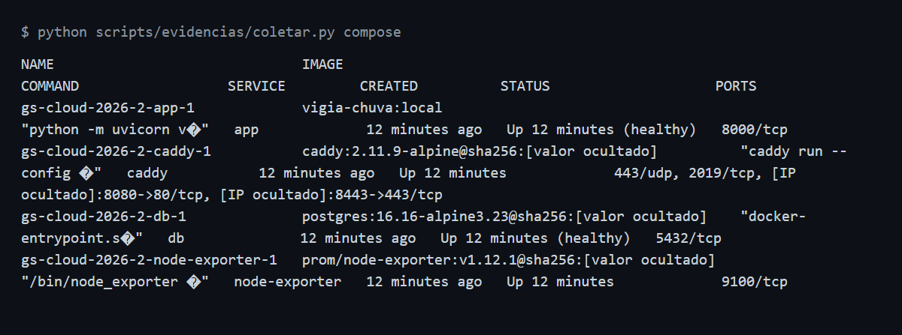

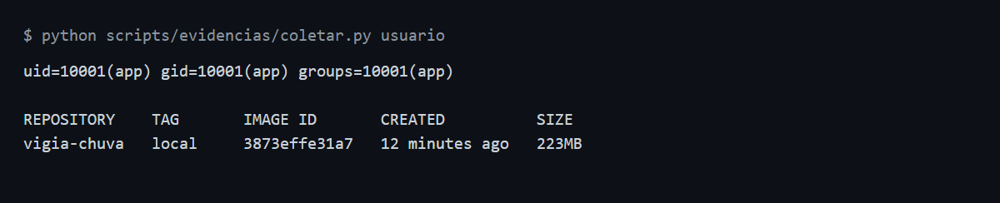

## 4. Infraestrutura como código

O bootstrap cria o storage do state. O módulo principal cria rede, NSG, IP/DNS, NIC, VM, ACR, Key Vault, identidades, papéis e orçamento. Os lockfiles dos providers ficam versionados; state, planos salvos, backend real, tfvars e segredos são ignorados pelo Git.

O storage do state fica em Brazil South. A VM, o banco de relatos, o ACR e o Key Vault ficam em North Central US. O state contém parâmetros sensíveis, incluindo segredos de runtime e o IP do operador; seu acesso usa Entra ID, RBAC e firewall, com versões mantidas durante a vida do ambiente.

Não existe regra SSH na implantação. A variável administrativa é opcional e recusa CIDRs amplos, incluindo `0.0.0.0/0`. A administração usa o plano de controle Azure. O firewall do Key Vault permite a subnet da VM e o IPv4 do operador; o storage do state também restringe a origem.

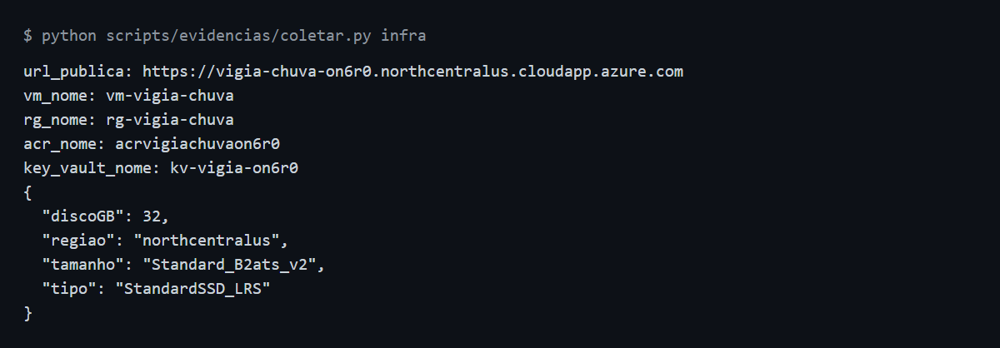

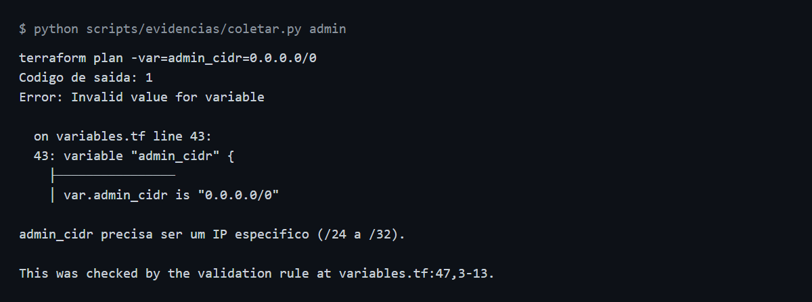

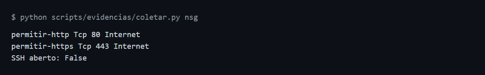

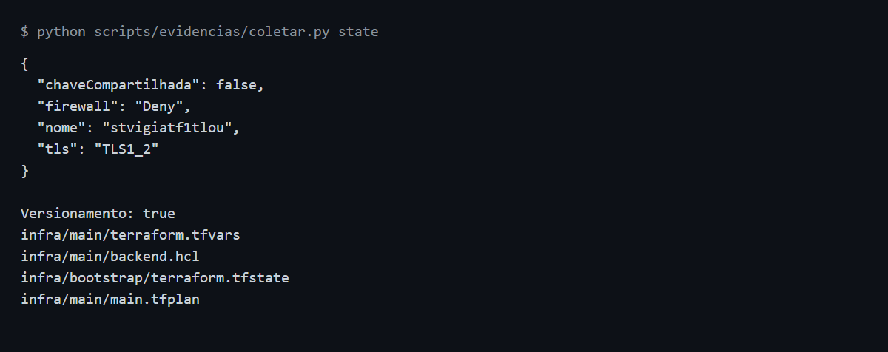

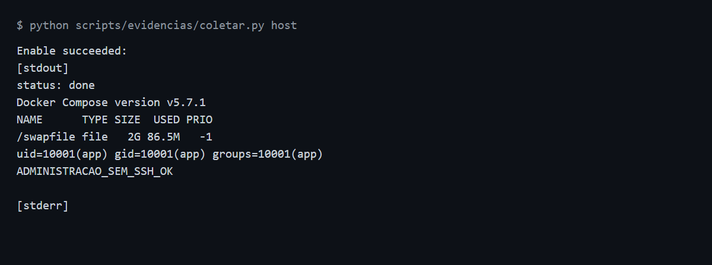

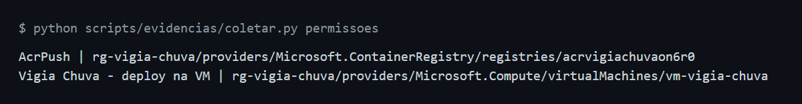

## 5. Pipeline DevSecOps

Testes e validação Terraform rodam junto de Gitleaks e Semgrep. A imagem só é construída após esses quatro jobs. Trivy bloqueia HIGH/CRITICAL com correção disponível e configurações inseguras na IaC e no Dockerfile. Na main, a imagem validada é exportada como artefato e usada no deploy, sem novo build.

| Etapa | Evidência do bloqueio |
|---|---|
| Gitleaks | Chave fictícia introduzida em branch de demonstração; execução barrada e versão corrigida, sem usar credencial real. |
| Semgrep | Padrão inseguro introduzido em branch de demonstração; execução barrada e versão corrigida. |
| Trivy | Scan da imagem e da infraestrutura antes do deploy. |
| Deploy | Token OIDC curto, envio ao ACR e Run Command com verificação explícita de `DEPLOY_OK`. |
| Rollback | O healthcheck inválido fez o deploy falhar; a imagem e os arquivos da versão anterior foram restaurados. |

Os testes de Gitleaks e Semgrep usaram branches fechadas sem merge. O teste de rollback foi executado na main e revertido após a confirmação da recuperação. A matriz ao final deste documento contém os links e resultados das execuções. A chave usada no teste era fictícia.

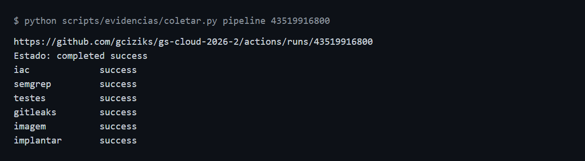

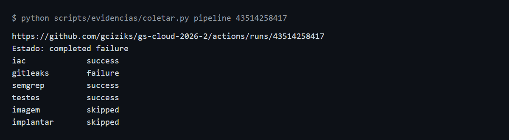

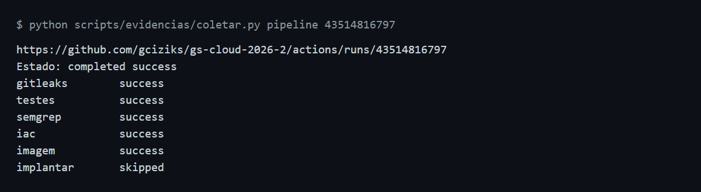

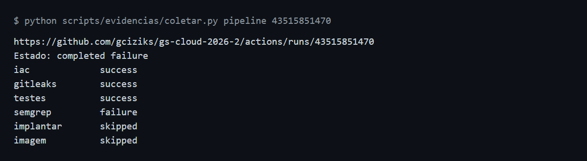

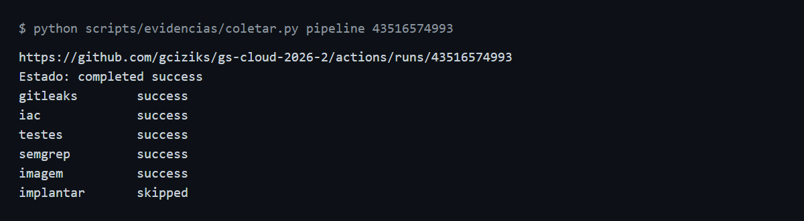

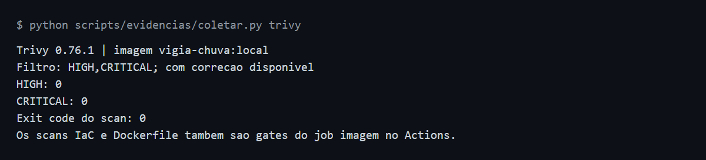

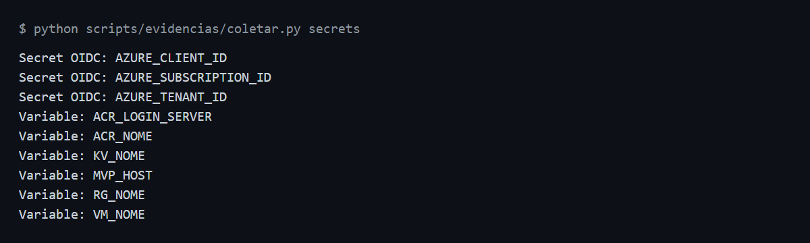

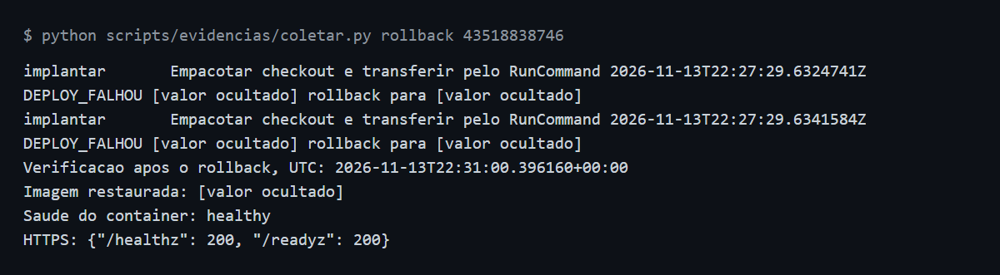

### Limites do scan

O bloqueio de CVEs da imagem cobre a aplicação construída pelo projeto. Uma inspeção adicional encontrou CVEs em dependências Go dos binários oficiais auxiliares, incluindo gosu no PostgreSQL, node-exporter e o parser HTML presente no Caddy. Não removemos esses achados por uma lista genérica de exceções e não declaramos que toda a stack está livre de CVEs. O exporter exige token no proxy e não publica porta; PostgreSQL não recebe tráfego externo. A avaliação de alcance de cada CVE e atualização dos binários auxiliares permanece uma limitação, com nova revisão necessária antes de uso além da demonstração acadêmica.

## 6. Observabilidade

Prometheus e Grafana rodam em Compose local, ouvindo apenas em 127.0.0.1. O Prometheus consulta `/metrics` e `/node-metrics` do MVP por HTTPS e bearer token, a cada 15 segundos. O dashboard e as quatro regras são provisionados por arquivo e persistem após reinício.

| Sinal | Medição |
|---|---|
| Latência | p50, p95 e p99 do histograma HTTP; consultas separadas por percentil. |
| Tráfego | Taxa de requisições por segundo, total e por template de rota. |
| Erros | Percentual de respostas 5xx e disponibilidade do scrape. |
| Saturação | CPU, memória, swap e disco do host; requisições em andamento e memória do processo. |

Os rótulos usam templates de rota, como `/municipio/{codigo}`, para evitar uma série por município ou URL de bot. IPs, bairros e referências não são labels. Métricas de carga local no Windows representam a VM LinuxKit; na implantação remota, o exporter mede a VM Ubuntu.

```text
Trafego: sum(rate(http_requests_total{route!="/metrics"}[1m]))
p95: histogram_quantile(0.95, sum by (le) (
  rate(http_request_duration_seconds_bucket{route!="/metrics"}[5m])))
Erros: 100 * (sum(rate(http_requests_total{status=~"5.."}[5m])) or vector(0))
  / clamp_min(sum(rate(http_requests_total[5m])), 1e-9)
CPU: 100 * (1 - avg(rate(node_cpu_seconds_total{mode="idle"}[5m])))
Memoria: 100 * (1 - node_memory_MemAvailable_bytes / node_memory_MemTotal_bytes)
```

A demonstração de indisponibilidade parou somente o serviço app. O alerta entrou em firing após um minuto sem scrape e enviou a notificação ao ntfy. Depois de iniciar o serviço, o alerta voltou ao estado Normal. As respostas coletadas estão em `docs/alerta.json`; os prints mostram esses resultados sem expor o tópico ou o token de métricas.

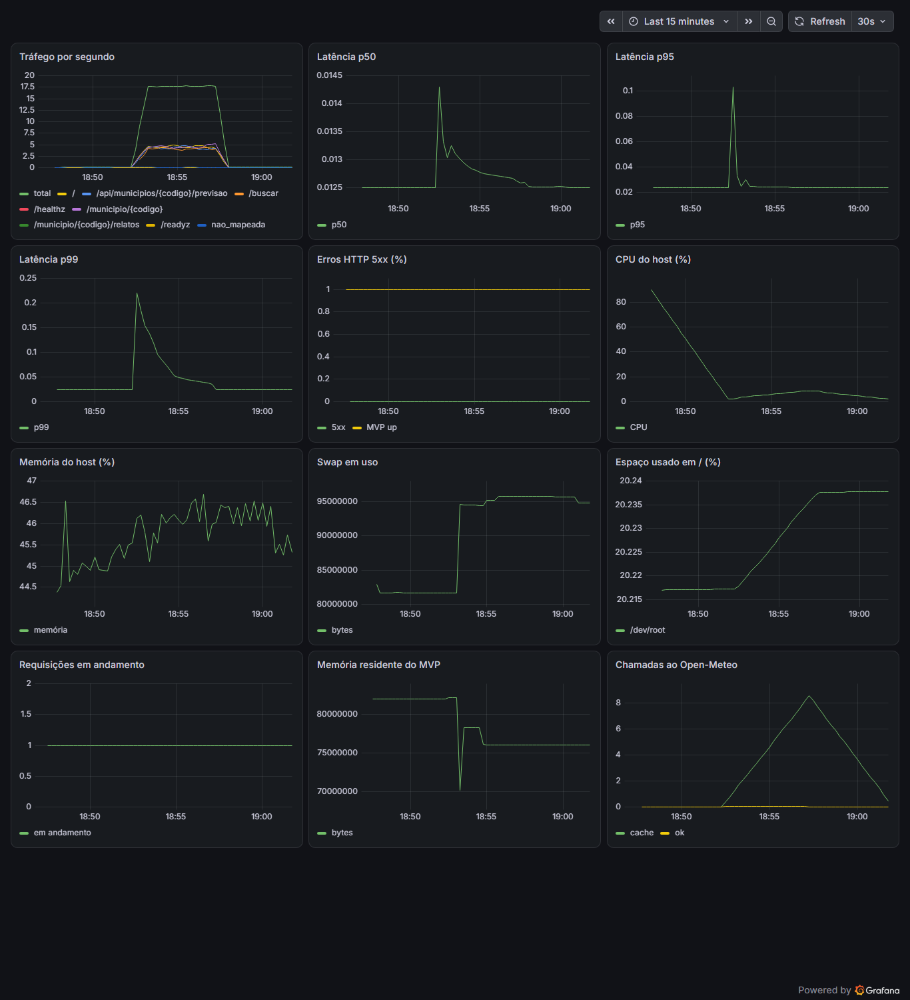

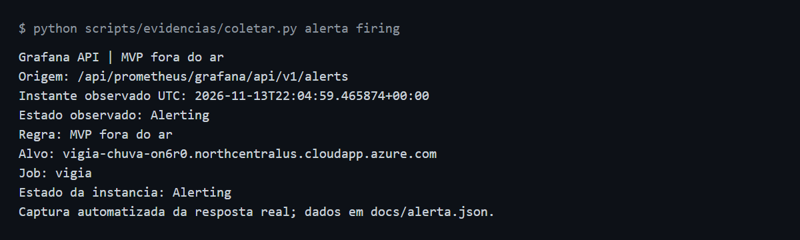

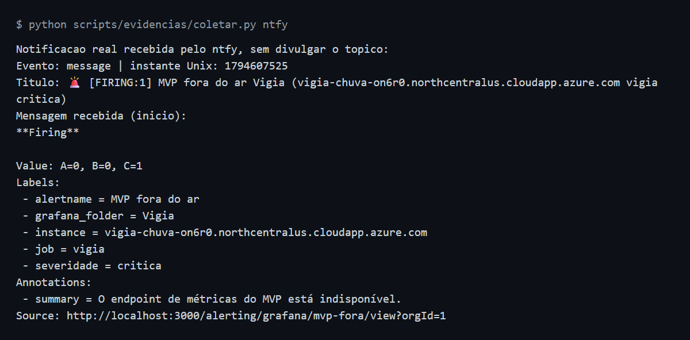

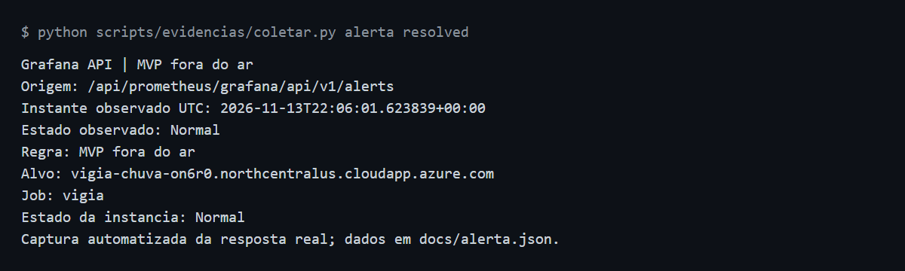

## 7. Responsabilidade compartilhada

| Camada | Provedor | Equipe |
|---|---|---|
| VM Azure, IaaS | Datacenter, hardware, hypervisor e rede física | SO, patches, Docker, aplicação, banco, disco lógico, NSG, acesso e dados |
| ACR, Key Vault e Storage, PaaS | Infraestrutura e atualização do serviço gerenciado | Identidades, permissões, firewall, retenção e conteúdo armazenado |
| GitHub Actions | Plataforma e runners hospedados | Workflow, versões, permissões, segredos, regras de bloqueio e código executado |
| Prometheus/Grafana locais | Infraestrutura do computador local sob gestão da equipe | Coleta, dashboard, alertas, volumes, senhas e disponibilidade da máquina |

A criptografia do disco gerenciado não substitui controle de acesso ao banco. O HMAC não torna um dado automaticamente anônimo. A proteção do pipeline depende de revisar alterações no workflow e no código com o mesmo cuidado.

## 8. Dados pessoais e LGPD

| Dado | Finalidade e local | Retenção e acesso |
|---|---|---|
| IP durante a requisição | Prevenir abuso; processado no servidor | Não armazenado em claro no banco; mascarado nos logs do proxy; logs de acesso do Uvicorn desativados |
| HMAC do IP e data | Limitar cinco relatos por hora; PostgreSQL da VM em North Central US | Pseudonimizado, removido após 24 h pela rotina a cada minuto; segredo no Key Vault |
| Bairro, referência e situação | Mostrar relatos locais; PostgreSQL no volume Docker | Exibição por 24 h; exclusão após sete dias; acesso administrativo da equipe |
| Métricas HTTP e do host | Operação e alerta; Prometheus/Grafana locais | Retenção de sete dias; sem IP ou conteúdo de relatos nos rótulos |

A equipe escolheu legítimo interesse como hipótese para a prevenção de abuso, com finalidade específica, coleta mínima e retenção curta. Não há login, publicidade nem rastreamento entre dias. A interface pede que não sejam enviados dados pessoais nos campos livres. A página de privacidade identifica o local de armazenamento e o canal de contato da equipe.

Há armazenamento nos Estados Unidos. Essa localização foi necessária pela restrição da assinatura e está declarada; não equivale, por si só, a comprovar todos os requisitos jurídicos de transferência internacional. Antes de ampliar o uso além da entrega acadêmica, é necessário formalizar o controlador, o mecanismo aplicável de transferência e a análise de legítimo interesse, conforme a LGPD e a orientação da ANPD.

## 9. Estimativa de custo

Preços de varejo em USD consultados em 13/11/2026 pela Azure Retail Prices API. Não presumimos benefício gratuito. O período de até 18 dias cobre a implantação e a referência de disponibilidade até 30/11.

| Item em North Central US | Preço unitário | Quantidade | Até 18 dias | Mês, 730 h |
|---|---|---|---|---|
| B2ats_v2 Linux | US$ 0,0094/h | 432 h | US$ 4,06 | US$ 6,86 |
| SSD E4 LRS, 32 GB | US$ 2,40/mês | 0,6 mês | US$ 1,44 | US$ 2,40 |
| IP Standard IPv4 | US$ 0,005/h | 432 h | US$ 2,16 | US$ 3,65 |
| ACR Basic | US$ 0,1666/dia | 18 dias | US$ 3,00 | US$ 5,07 |
| Subtotal fixo | | | US$ 10,66 | US$ 17,98 |
| Reserva para operações e tráfego leve | | | US$ 1,34 | Conforme uso |
| Estimativa do período | | | US$ 12,00 | |

A reserva cobre pequenas operações de disco, Key Vault, storage do state e tráfego. Não inclui recursos de outros projetos da assinatura nem uso fora da franquia GitHub Actions. Câmbio, tributos, tráfego elevado e tempo adicional alteram o valor. O orçamento de R$ 60 usa a moeda de cobrança da assinatura, filtra os resource groups deste projeto e envia avisos; não é um bloqueio automático de gastos.

Brazil South tinha B2ats_v2 a US$ 0,0151/h e não permitia esse tamanho na assinatura. A escolha econômica e tecnicamente disponível foi North Central US a US$ 0,0094/h. Prometheus e Grafana locais evitam custo adicional de observabilidade na nuvem. Os dados consultados e as contas estão em `docs/custos.json`.

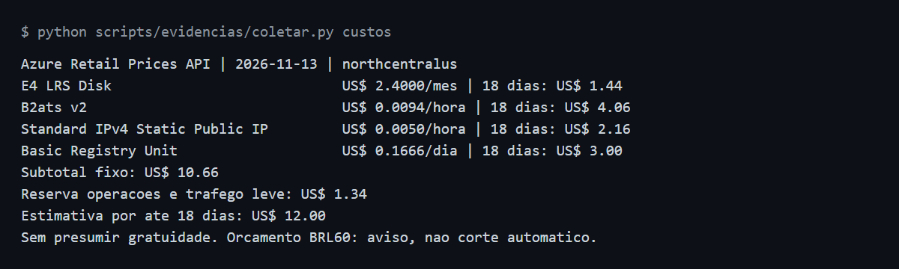

## 10. Teste do avaliador e limitações

O avaliador pode consultar o MVP por HTTPS sem login e reproduzir a stack com os comandos do README. A classificação usa os limiares adaptados do INMET; o acumulado de 30 mm para atenção é uma escolha da equipe. Open-Meteo pode ficar indisponível; a interface informa o estado e usa cache quando disponível.

A suíte completa passou nos 38 testes, incluindo PostgreSQL e concorrência do limite por IP. No MVP publicado, o teste navegou pela busca, enviou um relato, conferiu a persistência e confirmou que cabeçalhos de IP forjados não contornam o limite. Os registros desse teste foram removidos. O Lighthouse registrou 100 em acessibilidade automática; isso não substitui avaliação manual com tecnologias assistivas.

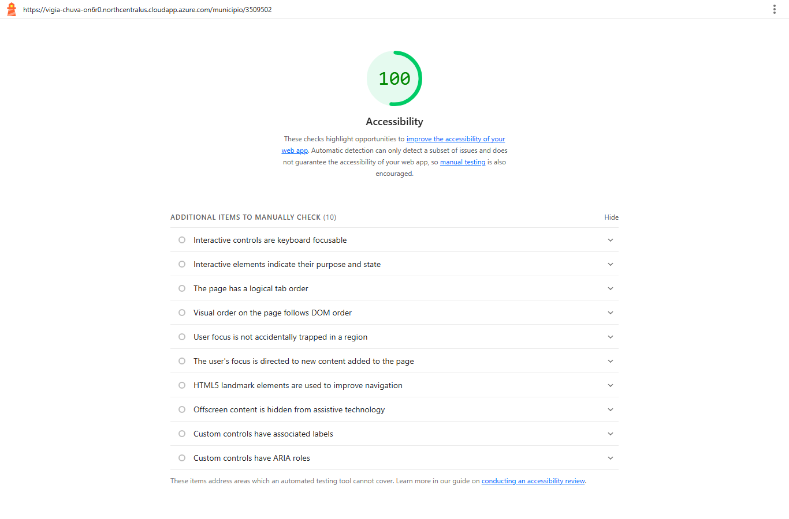

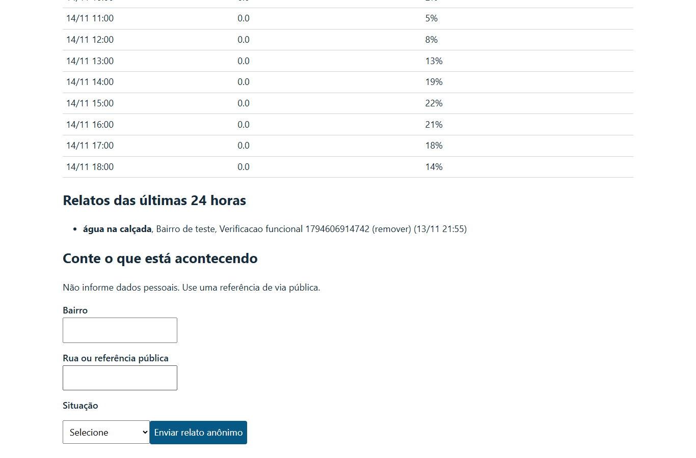

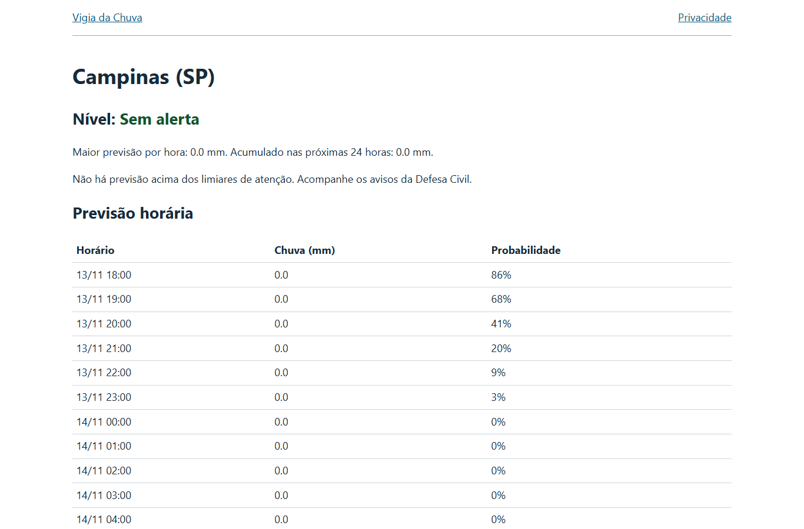

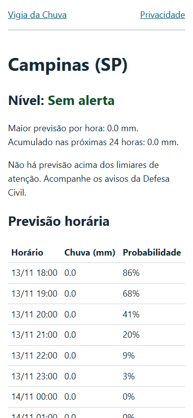

Não há alta disponibilidade nem backup externo automatizado do banco. Os relatos são temporários, mas uma falha do disco pode causar perda. Os próximos passos são testar restauração de backup, usar PostgreSQL gerenciado, revisar CVEs auxiliares, formalizar o tratamento de dados para uso real e avaliar Azure Monitor e WAF.

## Fontes

- [Open-Meteo, API e licença](https://open-meteo.com/), [condições do endpoint gratuito](https://open-meteo.com/en/terms).
- [IBGE, localidades](https://servicodados.ibge.gov.br/api/docs/localidades) e [base de coordenadas, licença MIT](https://github.com/kelvins/municipios-brasileiros).
- [INMET, exemplo oficial de aviso de chuvas intensas](https://avisos.inmet.gov.br/53675).
- [ANPD, guia de legítimo interesse](https://www.gov.br/anpd/pt-br/centrais-de-conteudo/materiais-educativos-e-publicacoes/guia_orientativo_hipoteses_legais_tratamento_de_dados_pessoais_legitimo_interesse).
- [Microsoft, responsabilidade compartilhada](https://learn.microsoft.com/azure/security/fundamentals/shared-responsibility).
- [Azure Retail Prices API](https://prices.azure.com/api/retail/prices).
